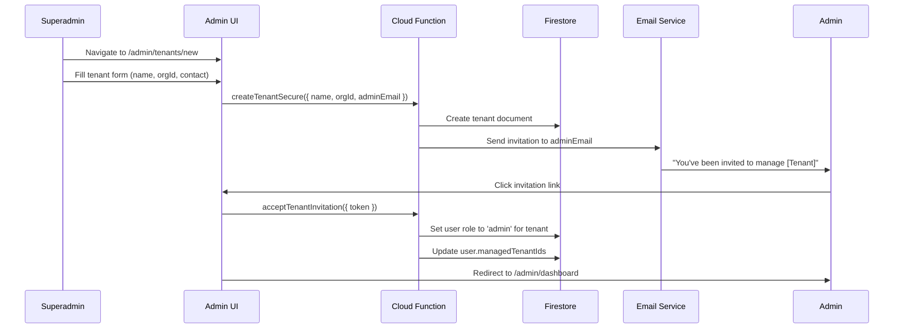
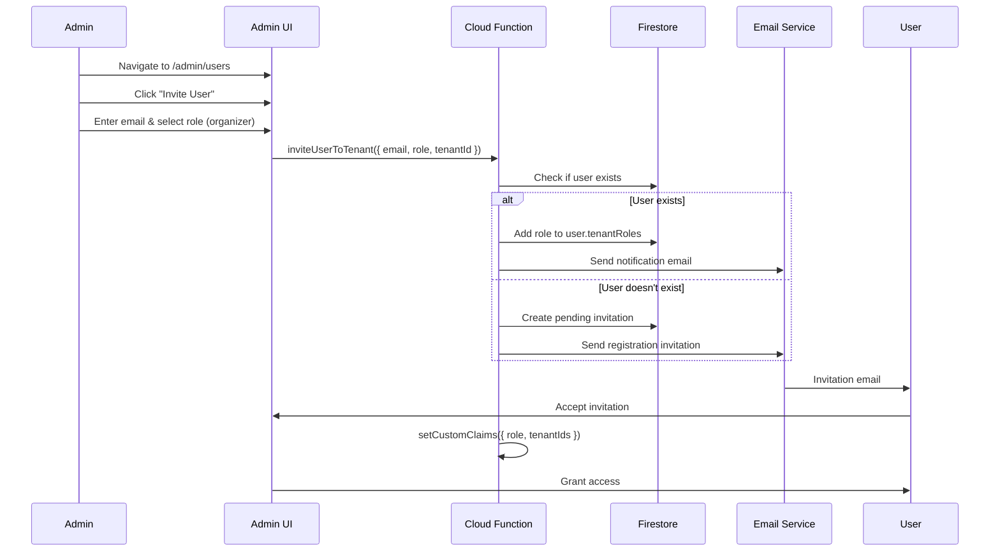
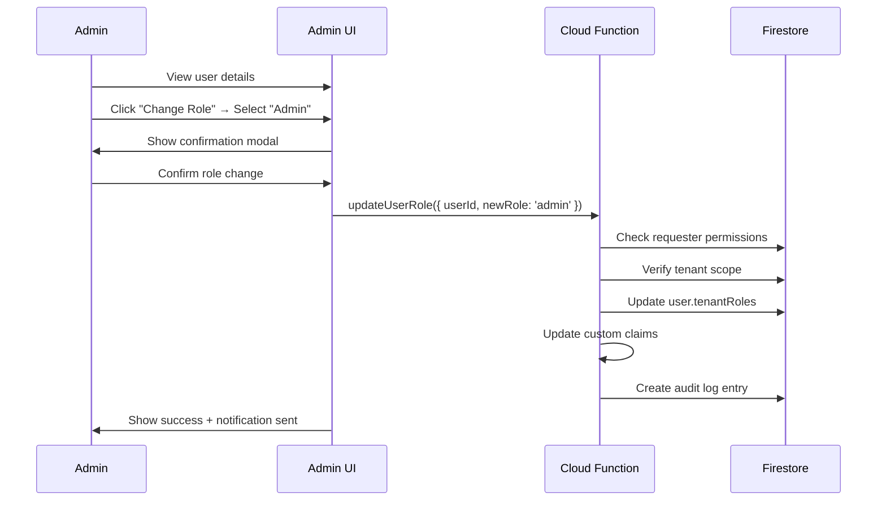
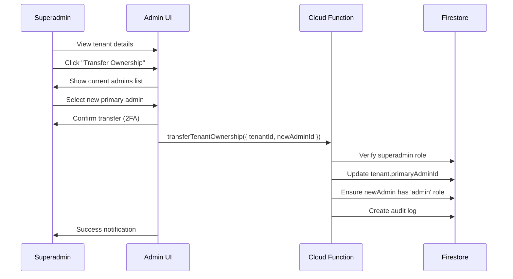
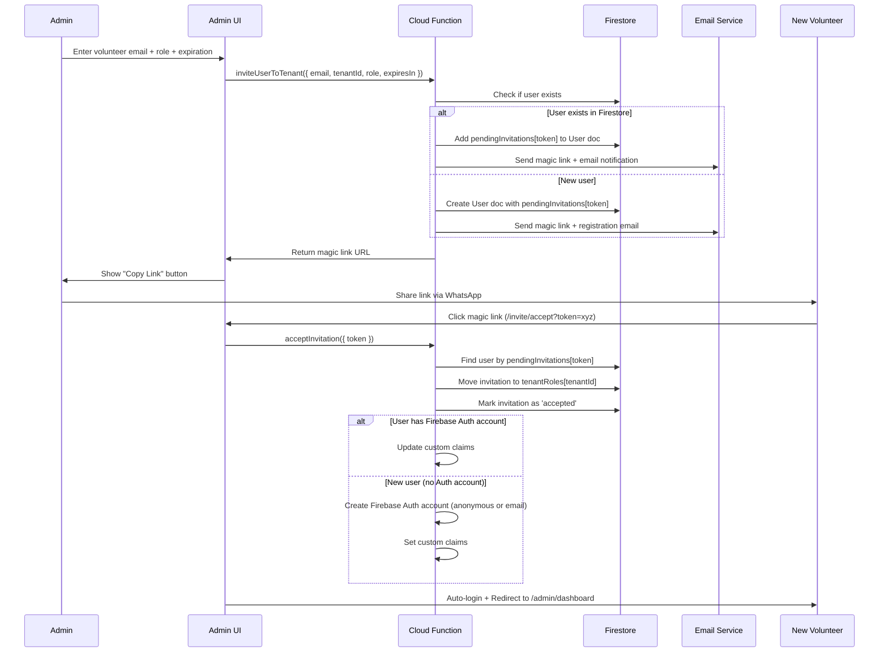

# Role Management Architecture for Urban Rally Admin Portal

> **Document Type:** Technical Architecture & Design Proposal  
> **Date:** December 30, 2025  
> **Author:** Senior Project Lead  
> **Status:** Proposal - Awaiting Stakeholder Decision

---

## Table of Contents

1. [Executive Summary](#executive-summary)
2. [Requirements Analysis](#requirements-analysis)
3. [Role Hierarchy Deep Dive](#role-hierarchy-deep-dive)
4. [User Management Workflows](#user-management-workflows)
5. [Architecture Approaches](#architecture-approaches)
6. [Data Model Design](#data-model-design)
7. [Security Considerations](#security-considerations)
8. [UI/UX Design](#uiux-design)
9. [Implementation Complexity](#implementation-complexity)
10. [Recommendation](#recommendation)
11. [Decision Points](#decision-points)

---

## Executive Summary

This document proposes a comprehensive role management system for Urban Rally's admin portal, enabling hierarchical user management across multiple tenants. The system must support:

- **Superadmin**: Global control over tenants and all roles
- **Admin**: Tenant-scoped control over organizers, moderators, and other admins
- **Organizer**: Event and task management (no user management)
- **Moderator**: Submission review only (no user management)

**Key Design Decision**: Whether to implement **flat role assignment** (simple but less flexible) vs **hierarchical permission inheritance** (complex but scalable).

**Recommendation**: Start with **Approach 2 (Hierarchical with Constraints)** - provides necessary flexibility while maintaining security boundaries.

---

## Requirements Analysis

### Functional Requirements

#### FR-1: Superadmin Capabilities
| ID | Requirement | Priority | Notes |
|----|-------------|----------|-------|
| FR-1.1 | Create new tenants (organizations) | P0 | Foundation of multi-tenancy |
| FR-1.2 | Assign ANY role to ANY user | P0 | Unrestricted role management |
| FR-1.3 | Promote users to superadmin | P1 | Requires confirmation dialog |
| FR-1.4 | Revoke any user's role | P0 | Including other superadmins |
| FR-1.5 | View all users across all tenants | P0 | Global user directory |
| FR-1.6 | Transfer tenant ownership | P1 | Change primary admin |
| FR-1.7 | Deactivate/reactivate tenants | P1 | Soft delete with restore |
| FR-1.8 | View cross-tenant analytics | P2 | Platform-wide insights |

#### FR-2: Admin Capabilities
| ID | Requirement | Priority | Notes |
|----|-------------|----------|-------|
| FR-2.1 | Invite users to their tenant(s) | P0 | Email invitation system |
| FR-2.2 | Assign admin role to users | P0 | Create peer admins |
| FR-2.3 | Assign organizer role to users | P0 | Event managers |
| FR-2.4 | Assign moderator role to users | P0 | Submission reviewers |
| FR-2.5 | Revoke roles within their tenant | P0 | Cannot revoke superadmin |
| FR-2.6 | View users within their tenant(s) | P0 | Tenant-scoped directory |
| FR-2.7 | Cannot promote to superadmin | P0 | Security boundary |
| FR-2.8 | Cannot manage users in other tenants | P0 | Tenant isolation |

#### FR-3: Role Assignment Constraints
| ID | Constraint | Rationale |
|----|-----------|-----------|
| FR-3.1 | Users can have different roles in different tenants | Flexibility for consultants |
| FR-3.2 | Users can have multiple roles in same tenant | E.g., admin + organizer |
| FR-3.3 | Role changes require email confirmation | Security verification |
| FR-3.4 | Cannot revoke own superadmin role | Prevent lockout |
| FR-3.5 | Last admin in tenant cannot revoke self | Prevent orphaned tenant |

### Non-Functional Requirements

#### NFR-1: Security
- Role checks via Firebase Custom Claims (server-side)
- Firestore Security Rules enforce role boundaries
- Audit log for all role changes
- Rate limiting on role assignment operations

#### NFR-2: Performance
- Role check latency < 100ms
- User search results < 500ms
- Batch role assignment for 100+ users
- Optimistic UI updates with rollback

#### NFR-3: Usability
- Intuitive role hierarchy visualization
- Clear permission explanations
- Undo capability for accidental role changes (5 min window)
- Role comparison matrix

---

## Role Hierarchy Deep Dive

### Current Role Structure

```
┌─────────────────────────────────────────────────────────────────────┐
│                    ROLE HIERARCHY (EXISTING)                         │
├─────────────────────────────────────────────────────────────────────┤
│                                                                      │
│   ┌─────────────────┐                                               │
│   │   SUPERADMIN    │  Global platform owner                        │
│   │                 │  • Create tenants                             │
│   │                 │  • Assign any role to anyone                  │
│   │                 │  • Access all tenants                         │
│   └────────┬────────┘                                               │
│            │                                                         │
│            │ can assign ▼                                           │
│            │                                                         │
│   ┌────────▼────────┐                                               │
│   │      ADMIN      │  Tenant owner/manager                         │
│   │                 │  • Manage tenant settings                     │
│   │                 │  • Assign admin/organizer/moderator           │
│   │                 │  • View tenant analytics                      │
│   └────────┬────────┘                                               │
│            │                                                         │
│            │ can assign ▼                                           │
│            │                                                         │
│   ┌────────▼────────┐                                               │
│   │    ORGANIZER    │  Event manager                                │
│   │                 │  • Create/edit/delete events                  │
│   │                 │  • Create/edit/delete tasks                   │
│   │                 │  • View event analytics                       │
│   └────────┬────────┘                                               │
│            │                                                         │
│            │ no management rights                                   │
│            │                                                         │
│   ┌────────▼────────┐                                               │
│   │    MODERATOR    │  Content reviewer                             │
│   │                 │  • Review submissions                         │
│   │                 │  • Approve/reject content                     │
│   │                 │  • View submission queue                      │
│   └─────────────────┘                                               │
│                                                                      │
└─────────────────────────────────────────────────────────────────────┘
```

### Expanded Capabilities Matrix

| Capability | Superadmin | Admin | Organizer | Moderator | Player |
|-----------|------------|-------|-----------|-----------|--------|
| **TENANT MANAGEMENT** |
| Create tenant | ✅ | ❌ | ❌ | ❌ | ❌ |
| Edit tenant settings | ✅ | ✅ (own) | ❌ | ❌ | ❌ |
| Delete tenant | ✅ | ❌ | ❌ | ❌ | ❌ |
| **USER MANAGEMENT** |
| View all users (global) | ✅ | ❌ | ❌ | ❌ | ❌ |
| View tenant users | ✅ | ✅ (own) | ❌ | ❌ | ❌ |
| Invite users | ✅ | ✅ (to tenant) | ❌ | ❌ | ❌ |
| Assign superadmin | ✅ | ❌ | ❌ | ❌ | ❌ |
| Assign admin | ✅ | ✅ (in tenant) | ❌ | ❌ | ❌ |
| Assign organizer | ✅ | ✅ (in tenant) | ❌ | ❌ | ❌ |
| Assign moderator | ✅ | ✅ (in tenant) | ❌ | ❌ | ❌ |
| Revoke any role | ✅ | ✅ (in tenant) | ❌ | ❌ | ❌ |
| **EVENT MANAGEMENT** |
| Create event | ✅ | ✅ | ✅ | ❌ | ❌ |
| Edit event | ✅ | ✅ | ✅ (own) | ❌ | ❌ |
| Delete event | ✅ | ✅ | ✅ (own) | ❌ | ❌ |
| **TASK MANAGEMENT** |
| Create task | ✅ | ✅ | ✅ | ❌ | ❌ |
| Edit task | ✅ | ✅ | ✅ (own) | ❌ | ❌ |
| Delete task | ✅ | ✅ | ✅ (own) | ❌ | ❌ |
| **SUBMISSION MANAGEMENT** |
| Review submissions | ✅ | ✅ | ✅ | ✅ | ❌ |
| Approve submission | ✅ | ✅ | ✅ | ✅ | ❌ |
| Reject submission | ✅ | ✅ | ✅ | ✅ | ❌ |
| **ANALYTICS** |
| View global analytics | ✅ | ❌ | ❌ | ❌ | ❌ |
| View tenant analytics | ✅ | ✅ (own) | ❌ | ❌ | ❌ |
| View event analytics | ✅ | ✅ | ✅ (own) | ❌ | ❌ |

### Multi-Tenant Role Scenarios

#### Scenario 1: Single Tenant User
```
User: alice@example.com
├─ Tenant: ESN Berlin
│  └─ Role: admin
└─ Can manage: Users in ESN Berlin only
```

#### Scenario 2: Multi-Tenant Consultant
```
User: consultant@agency.com
├─ Tenant: ESN Berlin
│  └─ Role: organizer
├─ Tenant: ESN Munich
│  └─ Role: organizer
└─ Tenant: ESN Hamburg
   └─ Role: admin
   
Can manage: Users in ESN Hamburg only (admin role)
Can create events in: All three tenants
```

#### Scenario 3: Platform Owner
```
User: owner@urbanrally.com
└─ Role: superadmin (no tenant restriction)
   
Can manage: Everything across all tenants
```

---

## User Management Workflows

### Workflow 1: Superadmin Creates Tenant & First Admin



**Key Steps:**
1. Superadmin fills tenant creation form
2. Cloud Function validates and creates tenant
3. System sends email invitation to designated admin email
4. Invited user clicks link and confirms
5. Role assignment is finalized
6. User gains access to tenant admin panel

### Workflow 2: Admin Invites Organizer to Tenant



**Key Steps:**
1. Admin searches for user or enters new email
2. Admin selects role (organizer/moderator/admin)
3. System checks if user already has account
4. If yes: Add role immediately + send notification
5. If no: Create pending invitation + send registration link
6. User completes registration/acceptance
7. Custom claims are updated

### Workflow 3: Admin Promotes Organizer to Admin



**Key Steps:**
1. Admin views user profile in their tenant
2. Clicks "Change Role" and selects new role
3. Confirmation modal explains new permissions
4. Admin confirms action
5. Cloud Function validates permissions
6. Role is updated in Firestore + Custom Claims
7. Audit log is created
8. User is notified via email

### Workflow 4: Superadmin Transfers Tenant Ownership



**Key Steps:**
1. Superadmin navigates to tenant settings
2. Clicks "Transfer Ownership"
3. System shows list of current admins in tenant
4. Superadmin selects new primary admin
5. 2FA confirmation required (security)
6. Cloud Function updates tenant ownership
7. Audit trail is created

---

## Architecture Approaches

### Approach 1: Flat Role Assignment (Simple)

**Description:** Users have a single highest role per tenant, with role hierarchy enforced in code.

#### Data Model

```typescript
interface User {
  uid: string;
  email: string;
  displayName: string;
  
  // Flat structure - one role per tenant
  tenantRoles: {
    [tenantId: string]: 'admin' | 'organizer' | 'moderator';
  };
  
  // Superadmin flag (global, no tenant scope)
  isSuperadmin: boolean;
  
  createdAt: Date;
  updatedAt: Date;
}

// Custom Claims (JWT)
{
  role: 'superadmin' | 'admin' | 'organizer' | 'moderator',
  tenantIds: string[],  // Flattened list of all tenants
  tenantRoles: { [tenantId: string]: string }
}
```

#### Pros ✅
- Simple to implement (1 week)
- Easy to reason about
- Fast permission checks (O(1) lookup)
- Minimal database queries
- Clear role hierarchy visualization

#### Cons ❌
- Cannot have multiple roles in same tenant
- Less flexible for edge cases
- Role promotion/demotion is binary
- Cannot assign temporary elevated permissions
- Difficult to add custom permissions later

#### Use Cases
- ✅ Small organizations (< 50 users)
- ✅ Simple role hierarchy
- ✅ Fixed permission sets
- ❌ Consultants with multiple roles
- ❌ Temporary access grants

---

### Approach 2: Hierarchical with Constraints (Recommended)

**Description:** Users can have multiple roles per tenant, with highest role taking precedence. Constraints prevent privilege escalation.

#### Data Model

```typescript
interface User {
  uid: string;
  email: string;
  displayName: string;
  
  // Multiple roles per tenant (array)
  tenantRoles: {
    [tenantId: string]: {
      roles: ('admin' | 'organizer' | 'moderator')[];
      primaryRole: 'admin' | 'organizer' | 'moderator';
      grantedBy: string;  // UID who assigned role
      grantedAt: Date;
    };
  };
  
  // Superadmin flag
  isSuperadmin: boolean;
  
  // Pending invitations
  pendingInvitations: {
    tenantId: string;
    role: string;
    invitedBy: string;
    expiresAt: Date;
    token: string;
  }[];
  
  createdAt: Date;
  updatedAt: Date;
}

// Custom Claims (JWT) - Flattened for performance
{
  role: 'superadmin' | 'admin' | 'organizer' | 'moderator',  // Highest role
  tenantIds: string[],
  tenantRoles: { [tenantId: string]: string[] }  // All roles per tenant
}
```

#### Pros ✅
- Flexible for real-world scenarios
- Supports multiple roles (admin + organizer)
- Can grant temporary elevated access
- Easier to extend with custom permissions
- Audit trail built-in (grantedBy, grantedAt)

#### Cons ❌
- More complex implementation (2-3 weeks)
- Slightly slower permission checks
- UI must handle multiple role display
- Risk of permission confusion
- More database queries for role resolution

#### Use Cases
- ✅ Medium to large organizations (50-500 users)
- ✅ Consultants with varying access levels
- ✅ Temporary role elevation needed
- ✅ Future-proof for custom permissions

---

### Approach 3: Permission-Based (Most Flexible)

**Description:** Granular permissions instead of fixed roles. Roles are permission presets.

#### Data Model

```typescript
interface User {
  uid: string;
  email: string;
  displayName: string;
  
  // Granular permissions per tenant
  tenantPermissions: {
    [tenantId: string]: {
      permissions: Permission[];
      inheritedFrom: 'admin' | 'organizer' | 'moderator' | 'custom';
    };
  };
  
  isSuperadmin: boolean;
  createdAt: Date;
  updatedAt: Date;
}

interface Permission {
  resource: 'tenants' | 'events' | 'tasks' | 'submissions' | 'users';
  actions: ('create' | 'read' | 'update' | 'delete')[];
  scope?: string;  // e.g., eventId, taskId
}

// Predefined role templates
const ROLE_TEMPLATES = {
  admin: [
    { resource: 'events', actions: ['create', 'read', 'update', 'delete'] },
    { resource: 'tasks', actions: ['create', 'read', 'update', 'delete'] },
    { resource: 'submissions', actions: ['read', 'update'] },
    { resource: 'users', actions: ['create', 'read', 'update'] },
  ],
  organizer: [
    { resource: 'events', actions: ['create', 'read', 'update'] },
    { resource: 'tasks', actions: ['create', 'read', 'update', 'delete'] },
  ],
  moderator: [
    { resource: 'submissions', actions: ['read', 'update'] },
  ],
};
```

#### Pros ✅
- Ultimate flexibility
- Can create custom roles easily
- Fine-grained access control
- Easy to add new resources/actions
- Supports complex authorization rules

#### Cons ❌
- Very complex implementation (4-6 weeks)
- Difficult to visualize for users
- Slower permission checks (O(n) checks)
- Risk of misconfiguration
- Over-engineering for current needs

#### Use Cases
- ✅ Enterprise (500+ users)
- ✅ Complex compliance requirements
- ✅ Dynamic permission requirements
- ❌ Small teams with simple hierarchies
- ❌ MVP/early stage products

---

### Approach 4: Hybrid (Role + Permission Override)

**Description:** Start with Approach 2 (hierarchical roles), but allow permission overrides for special cases.

#### Data Model

```typescript
interface User {
  uid: string;
  email: string;
  displayName: string;
  
  // Base role structure
  tenantRoles: {
    [tenantId: string]: {
      roles: ('admin' | 'organizer' | 'moderator')[];
      primaryRole: string;
      grantedBy: string;
      grantedAt: Date;
    };
  };
  
  // Permission overrides (optional)
  permissionOverrides?: {
    [tenantId: string]: {
      granted: Permission[];  // Additional permissions
      revoked: Permission[];   // Explicitly removed permissions
    };
  };
  
  isSuperadmin: boolean;
  createdAt: Date;
  updatedAt: Date;
}
```

#### Pros ✅
- Best of both worlds
- Start simple, extend when needed
- Handles 90% of cases with roles
- Allows special cases without full permission system
- Easier migration path to full RBAC

#### Cons ❌
- More complex than Approach 2
- Permission override UI is tricky
- Risk of inconsistent state
- Documentation overhead

#### Use Cases
- ✅ Growing organizations (100-500 users)
- ✅ Some complex permission needs
- ✅ Want flexibility without full RBAC
- ✅ Plan to scale to enterprise

---

## Data Model Design

### Recommended Schema (Approach 2)

#### Collection: `users`

```typescript
interface User {
  // Identity
  id: string;                     // Firebase Auth UID
  email: string;
  displayName: string;
  photoURL?: string;
  
  // Role Management
  tenantRoles: {
    [tenantId: string]: {
      roles: ('admin' | 'organizer' | 'moderator')[];
      primaryRole: 'admin' | 'organizer' | 'moderator';
      grantedBy: string;          // UID of assigner
      grantedAt: Date;
      notes?: string;             // Optional reason for role
    };
  };
  
  isSuperadmin: boolean;
  
  // Invitation Management
  pendingInvitations: PendingInvitation[];
  
  // Account Status
  isActive: boolean;
  accountType: 'anonymous' | 'linked';  // Player account type
  
  // Metadata
  role: 'player' | 'moderator' | 'organizer' | 'admin' | 'superadmin';  // Highest role
  createdAt: Date;
  updatedAt: Date;
  lastLoginAt?: Date;
  
  // Player fields (if also a player)
  totalScore?: number;
  totalSubmissions?: number;
  eventsParticipated?: number;
  consentGiven?: ConsentData;
}

interface PendingInvitation {
  tenantId: string;
  tenantName: string;
  role: 'admin' | 'organizer' | 'moderator';
  invitedBy: string;              // UID
  invitedByName: string;
  invitedAt: Date;
  expiresAt: Date;
  token: string;                  // Secure random token
  status: 'pending' | 'accepted' | 'declined' | 'expired';
}
```

#### Collection: `tenants`

```typescript
interface Tenant {
  id: string;
  name: string;
  orgId: string;                  // Unique organization identifier
  
  // Ownership
  primaryAdminId: string;         // Main admin UID
  adminIds: string[];             // All admins for this tenant
  
  // Settings
  isActive: boolean;
  features: {
    maxEvents: number;
    maxTeamsPerEvent: number;
    customBranding: boolean;
    apiAccess: boolean;
  };
  
  // Branding
  logoUrl?: string;
  primaryColor?: string;
  
  // Metadata
  createdAt: Date;
  updatedAt: Date;
  createdBy: string;              // Superadmin UID
}
```

#### Collection: `roleAssignments` (Audit Log)

```typescript
interface RoleAssignment {
  id: string;
  
  // Who
  assignerId: string;             // Who made the change
  assignerEmail: string;
  targetUserId: string;           // Who was affected
  targetUserEmail: string;
  
  // What
  action: 'grant' | 'revoke' | 'modify';
  rolesBefore: string[];
  rolesAfter: string[];
  tenantId: string;
  
  // When & Why
  timestamp: Date;
  reason?: string;                // Optional explanation
  
  // Context
  ipAddress?: string;
  userAgent?: string;
}
```

---

## Security Considerations

### Firebase Custom Claims Strategy

#### Custom Claims Structure

```typescript
// Stored in Firebase Auth token (max 1000 bytes)
interface CustomClaims {
  // Highest role (for quick checks)
  role: 'superadmin' | 'admin' | 'organizer' | 'moderator' | 'player';
  
  // Tenant access list (for multi-tenant checks)
  tenantIds: string[];
  
  // Detailed role mapping (compressed)
  tr: {  // tenantRoles (abbreviated to save space)
    [tenantId: string]: string;  // Primary role only
  };
  
  // Superadmin flag
  sa?: boolean;  // isSuperadmin
  
  // Issued timestamp (for cache invalidation)
  iat: number;
}
```

#### Firestore Security Rules

```javascript
rules_version = '2';
service cloud.firestore {
  match /databases/{database}/documents {
    
    // Helper functions
    function isSuperadmin() {
      return request.auth != null && request.auth.token.sa == true;
    }
    
    function isAdmin(tenantId) {
      return request.auth != null 
          && request.auth.token.tr[tenantId] == 'admin';
    }
    
    function isOrganizer(tenantId) {
      return request.auth != null 
          && request.auth.token.tr[tenantId] in ['admin', 'organizer'];
    }
    
    function isModerator(tenantId) {
      return request.auth != null 
          && tenantId in request.auth.token.tenantIds;
    }
    
    // Tenants collection
    match /tenants/{tenantId} {
      // Superadmins can do anything
      allow read, write: if isSuperadmin();
      
      // Admins can read/update their own tenant
      allow read, update: if isAdmin(tenantId);
      
      // Organizers can read tenant settings
      allow read: if isOrganizer(tenantId);
    }
    
    // Users collection (admin user management)
    match /users/{userId} {
      // Users can read their own profile
      allow read: if request.auth.uid == userId;
      
      // Superadmins can read/write all users
      allow read, write: if isSuperadmin();
      
      // Admins can read users in their tenants
      allow read: if request.auth != null 
                  && hasIntersection(
                      resource.data.tenantRoles.keys(),
                      request.auth.token.tenantIds
                    );
      
      // Admins can update user roles in their tenants (via Cloud Function)
      allow write: if false;  // All writes go through Cloud Functions
    }
    
    // Role assignments (audit log)
    match /roleAssignments/{assignmentId} {
      // Only Cloud Functions can write
      allow write: if false;
      
      // Superadmins can read all
      allow read: if isSuperadmin();
      
      // Admins can read assignments in their tenants
      allow read: if request.auth != null
                  && resource.data.tenantId in request.auth.token.tenantIds
                  && isAdmin(resource.data.tenantId);
    }
    
    // Helper function
    function hasIntersection(array1, array2) {
      return array1.hasAny(array2);
    }
  }
}
```

### Cloud Functions for Role Management

#### Function: `assignRole`

```typescript
export const assignRole = onCall(
  { cors: true, region: 'europe-west3' },
  async (request) => {
    const { targetUserId, tenantId, role, reason } = request.data;
    
    // Validate requester
    if (!request.auth) {
      throw new HttpsError('unauthenticated', 'Must be logged in');
    }
    
    const assignerId = request.auth.uid;
    const assignerClaims = request.auth.token;
    
    // Check permissions
    const isSuperadmin = assignerClaims.sa === true;
    const isAdmin = assignerClaims.tr?.[tenantId] === 'admin';
    
    if (!isSuperadmin && !isAdmin) {
      throw new HttpsError(
        'permission-denied',
        'Only superadmins or tenant admins can assign roles'
      );
    }
    
    // Prevent non-superadmins from assigning superadmin
    if (role === 'superadmin' && !isSuperadmin) {
      throw new HttpsError(
        'permission-denied',
        'Only superadmins can assign superadmin role'
      );
    }
    
    // Get target user
    const userRef = db.collection('users').doc(targetUserId);
    const userDoc = await userRef.get();
    
    if (!userDoc.exists) {
      throw new HttpsError('not-found', 'User not found');
    }
    
    const userData = userDoc.data()!;
    
    // Update user roles
    const tenantRoles = userData.tenantRoles || {};
    const existingRoles = tenantRoles[tenantId]?.roles || [];
    
    // Add new role if not already present
    if (!existingRoles.includes(role)) {
      existingRoles.push(role);
    }
    
    tenantRoles[tenantId] = {
      roles: existingRoles,
      primaryRole: role,  // New role becomes primary
      grantedBy: assignerId,
      grantedAt: FieldValue.serverTimestamp(),
      notes: reason,
    };
    
    // Update Firestore
    await userRef.update({
      tenantRoles,
      updatedAt: FieldValue.serverTimestamp(),
    });
    
    // Update Custom Claims
    const allTenantIds = Object.keys(tenantRoles);
    const highestRole = getHighestRole(tenantRoles);
    
    await admin.auth().setCustomUserClaims(targetUserId, {
      role: highestRole,
      tenantIds: allTenantIds,
      tr: Object.fromEntries(
        allTenantIds.map(tid => [tid, tenantRoles[tid].primaryRole])
      ),
      sa: userData.isSuperadmin || false,
      iat: Date.now(),
    });
    
    // Create audit log
    await db.collection('roleAssignments').add({
      assignerId,
      assignerEmail: request.auth.token.email,
      targetUserId,
      targetUserEmail: userData.email,
      action: 'grant',
      rolesBefore: existingRoles,
      rolesAfter: tenantRoles[tenantId].roles,
      tenantId,
      timestamp: FieldValue.serverTimestamp(),
      reason: reason || null,
      ipAddress: request.rawRequest?.ip,
    });
    
    return {
      success: true,
      newRoles: tenantRoles[tenantId].roles,
    };
  }
);

function getHighestRole(tenantRoles: any): string {
  const hierarchy = ['superadmin', 'admin', 'organizer', 'moderator', 'player'];
  let highest = 'player';
  
  for (const tenantId in tenantRoles) {
    const roles = tenantRoles[tenantId].roles;
    for (const role of roles) {
      if (hierarchy.indexOf(role) < hierarchy.indexOf(highest)) {
        highest = role;
      }
    }
  }
  
  return highest;
}
```

---

## UI/UX Design

### User Management Dashboard

#### Superadmin View

```
┌─────────────────────────────────────────────────────────────────┐
│ 🌐 User Management - Global View                         [Search]│
├─────────────────────────────────────────────────────────────────┤
│                                                                  │
│ Filters: [All Tenants ▼] [All Roles ▼] [Active ▼]              │
│                                                                  │
│ ┌──────────────────────────────────────────────────────────────┐│
│ │ Email              │ Role        │ Tenants       │ Actions   ││
│ ├──────────────────────────────────────────────────────────────┤│
│ │ owner@ur.com       │ SUPERADMIN  │ All          │ [Edit]     ││
│ │ admin@esn.org      │ Admin       │ ESN Berlin   │ [Edit]     ││
│ │                    │             │ ESN Munich   │            ││
│ │ org@esn.org        │ Organizer   │ ESN Berlin   │ [Edit]     ││
│ │ mod@esn.org        │ Moderator   │ ESN Berlin   │ [Edit]     ││
│ └──────────────────────────────────────────────────────────────┘│
│                                                                  │
│ [+ Invite User]  [+ Create Tenant]  [View Audit Log]            │
└─────────────────────────────────────────────────────────────────┘
```

#### Admin View (Tenant-Scoped)

```
┌─────────────────────────────────────────────────────────────────┐
│ 👥 User Management - ESN Berlin                          [Search]│
├─────────────────────────────────────────────────────────────────┤
│                                                                  │
│ You can manage users in: ESN Berlin                             │
│                                                                  │
│ ┌──────────────────────────────────────────────────────────────┐│
│ │ Email              │ Role        │ Granted     │ Actions     ││
│ ├──────────────────────────────────────────────────────────────┤│
│ │ admin@esn.org      │ Admin       │ You         │ [View]      ││
│ │ org1@esn.org       │ Organizer   │ admin@esn   │ [Edit]      ││
│ │ org2@esn.org       │ Organizer   │ admin@esn   │ [Edit]      ││
│ │ mod@esn.org        │ Moderator   │ admin@esn   │ [Edit]      ││
│ └──────────────────────────────────────────────────────────────┘│
│                                                                  │
│ [+ Invite User]  [View Activity Log]                            │
└─────────────────────────────────────────────────────────────────┘
```

### Role Assignment Modal

```
┌─────────────────────────────────────────────────────────────────┐
│ Assign Role to user@example.com                          [×]     │
├─────────────────────────────────────────────────────────────────┤
│                                                                  │
│ Tenant: ESN Berlin                                              │
│                                                                  │
│ Select Role:                                                    │
│                                                                  │
│ ○ Admin                                                         │
│   Can manage users, events, tasks, and submissions             │
│   Can invite and assign roles to organizers and moderators     │
│                                                                  │
│ ○ Organizer                                                     │
│   Can create and manage events and tasks                       │
│   Can review submissions                                        │
│                                                                  │
│ ○ Moderator                                                     │
│   Can review and approve/reject submissions                     │
│                                                                  │
│ Reason (optional):                                              │
│ [_____________________________________________________]          │
│                                                                  │
│ ⚠️ This user will receive an email notification                 │
│                                                                  │
│            [Cancel]                    [Assign Role]            │
└─────────────────────────────────────────────────────────────────┘
```

### Multi-Role Badge Display

```
┌─────────────────────────────────────────┐
│ consultant@agency.com                   │
├─────────────────────────────────────────┤
│                                         │
│ Roles across tenants:                   │
│                                         │
│ ESN Berlin:    [Admin] [Organizer]     │
│ ESN Munich:    [Organizer]             │
│ ESN Hamburg:   [Admin]                  │
│                                         │
│ Primary Role:  Admin                    │
│ Access Level:  3 Tenants                │
│                                         │
│ [Edit Roles]                           │
└─────────────────────────────────────────┘
```

---

## Implementation Complexity

### Development Effort Estimate

#### Approach 1 (Flat Roles)
| Component | Hours | Notes |
|-----------|-------|-------|
| Data model design | 4 | Simple structure |
| Cloud Functions | 16 | assignRole, revokeRole, inviteUser |
| Firestore rules | 8 | Tenant isolation |
| Admin UI components | 24 | User list, role modal |
| Testing | 16 | Unit + integration |
| **Total** | **68** | **~2 weeks** |

#### Approach 2 (Hierarchical) - RECOMMENDED
| Component | Hours | Notes |
|-----------|-------|-------|
| Data model design | 8 | Complex structure + audit |
| Cloud Functions | 32 | Role management + invitation flow |
| Firestore rules | 16 | Multi-role validation |
| Admin UI components | 40 | User list, multi-role display, audit log |
| Custom Claims refresh | 8 | Token update strategy |
| Testing | 24 | Unit + integration + E2E |
| **Total** | **128** | **~3-4 weeks** |

#### Approach 3 (Permission-Based)
| Component | Hours | Notes |
|-----------|-------|-------|
| Data model design | 16 | Permission schema |
| Cloud Functions | 48 | Permission resolver, templates |
| Firestore rules | 24 | Granular checks |
| Admin UI components | 56 | Permission matrix UI |
| Permission engine | 16 | Check logic |
| Testing | 32 | Complex test cases |
| **Total** | **192** | **~5-6 weeks** |

#### Approach 4 (Hybrid)
| Component | Hours | Notes |
|-----------|-------|-------|
| Data model design | 12 | Role + overrides |
| Cloud Functions | 40 | Role + permission APIs |
| Firestore rules | 20 | Dual-mode checks |
| Admin UI components | 48 | Role UI + override UI |
| Testing | 28 | Edge cases |
| **Total** | **148** | **~4 weeks** |

### Risk Assessment

| Risk | Approach 1 | Approach 2 | Approach 3 | Approach 4 |
|------|-----------|-----------|-----------|-----------|
| Over-engineering | Low | Low | **High** | Medium |
| Under-engineering | **High** | Low | Low | Low |
| Security gaps | Medium | Low | Low | Low |
| Performance issues | Low | Low | Medium | Medium |
| User confusion | Low | Low | **High** | Medium |
| Maintenance burden | Low | Medium | **High** | Medium |
| Migration difficulty | **High** | Medium | Low | Medium |

---

## Recommendation

### Primary Recommendation: **Approach 2 (Hierarchical with Constraints)**

#### Why This Approach?

1. **Balances Simplicity and Flexibility**
   - Simple enough to implement in 3-4 weeks
   - Flexible enough for real-world use cases
   - Supports multi-tenant consultants

2. **Future-Proof Without Over-Engineering**
   - Can add permission overrides later if needed
   - Doesn't lock you into rigid structure
   - Easy to migrate to Approach 4 if requirements grow

3. **Aligns with Current Architecture**
   - Extends existing User schema cleanly
   - Uses Firebase Custom Claims (already planned)
   - Firestore rules are straightforward

4. **Good Developer Experience**
   - Clear role hierarchy
   - Easy to debug and reason about
   - Audit trail built-in

5. **Good User Experience**
   - Intuitive role badges
   - Clear permission explanations
   - Multi-role display makes sense

#### Implementation Roadmap

**Week 1: Foundation**
- Design final schema with team review
- Implement Cloud Functions (assignRole, revokeRole, inviteUser)
- Set up Firestore security rules
- Create audit log collection

**Week 2: Core UI**
- Build user management dashboard
- Implement role assignment modal
- Add user search and filtering
- Create role badge components

**Week 3: Advanced Features**
- Multi-tenant role display
- Invitation flow (email + acceptance)
- Audit log viewer
- Role change notifications

**Week 4: Polish & Testing**
- E2E tests for role flows
- Security audit
- Performance optimization
- Documentation

#### Alternative: Start with Approach 1, Plan Migration

If development resources are very limited, you could:

1. **Phase 1**: Implement Approach 1 (2 weeks)
   - Launch with flat roles
   - Get user feedback
   - Validate core workflows

2. **Phase 2**: Migrate to Approach 2 (1 week migration)
   - Add multi-role support
   - Backfill existing users
   - Update UI components

This de-risks the project but adds migration complexity later.

---

## Decision Points - FINALIZED

### ✅ Approved Architecture: "Scoped RBAC" Model

Based on stakeholder input and real-world event management requirements, the following decisions have been finalized:

---

#### 1. Role Hierarchy Approach ✅

**Decision:** **Option B (Hierarchical Multi-roles) with Role Inheritance**

**Rationale:**
- Event management requires clear chain of command: Superadmin > Admin > Organizer > Moderator
- Backend uses distinct permissions (`can_delete_team`), but UI shows fixed roles only
- **No permission toggles** - prevents configuration chaos during live events

**Implementation:**
```typescript
const ROLE_HIERARCHY = {
  superadmin: { level: 4, inherits: ['admin', 'organizer', 'moderator'] },
  admin: { level: 3, inherits: ['organizer', 'moderator'] },
  organizer: { level: 2, inherits: ['moderator'] },
  moderator: { level: 1, inherits: [] },
};

// Permission check: if (user.role.level >= MODERATOR_LEVEL)
```

---

#### 2. Multi-Tenant Role Assignment ✅

**Decision:** **Yes** - Different roles in different tenants

**Rationale:**
- ESN members frequently move cities or help neighboring sections
- Alice shouldn't have "God Mode" in Munich just because she runs Berlin
- Supports real-world consultant/volunteer scenarios

**Critical Fix: Context Switcher**
```
┌─────────────────────────────────────────┐
│ [ESN Berlin ▼]  🔔  👤 Alice            │  ← Navbar
├─────────────────────────────────────────┤
│ Current Context: ESN Berlin             │
│ Your Role: Admin                        │
│                                         │
│ Switch to:                              │
│ • ESN Munich (Organizer)                │
│ • ESN Hamburg (Moderator)               │
└─────────────────────────────────────────┘
```

**Implementation Notes:**
- Visual context switcher in navbar (like GitHub/Slack)
- **Entire UI reloads** to reflect active tenant permissions
- No cross-tenant data leakage in UI state

---

#### 3. Multiple Roles per Tenant ✅

**Decision:** **No** - Single highest role per tenant

**Rationale:**
- "Bob is Admin AND Moderator" adds unnecessary code complexity
- Use **Role Inheritance** instead: Admin automatically has Moderator capabilities
- Simplifies UI to single dropdown per user

**Code Pattern:**
```typescript
// ❌ BAD: Multiple role checks
if (user.roles.includes('admin') || user.roles.includes('moderator')) { ... }

// ✅ GOOD: Single level check
if (user.role.level >= ROLE_HIERARCHY.moderator.level) { ... }
```

---

#### 4. Invitation System ✅

**Decision:** **"Copy Link" (Magic Link) - No passwords**

**Rationale:**
- Pre-creating accounts with passwords is a security risk
- "I didn't get the email" is #1 support ticket during events
- Admins can share links directly via WhatsApp/Telegram

**UI Implementation:**
```
┌─────────────────────────────────────────────────────────┐
│ Invite User to ESN Berlin                               │
├─────────────────────────────────────────────────────────┤
│ Email: volunteer@example.com                            │
│ Role: [Moderator ▼]                                     │
│ Expires: [1 Week ▼]                                     │
│                                                         │
│ ┌─────────────────────────────────────────────────────┐ │
│ │ https://urbanrally.app/invite/abc123xyz             │ │
│ │                                      [Copy Link 📋] │ │
│ └─────────────────────────────────────────────────────┘ │
│                                                         │
│ ✅ Link copied! Share via WhatsApp or Email            │
│                                                         │
│ [Send Email Automatically]         [Close]              │
└─────────────────────────────────────────────────────────┘
```

**Flow:**
1. Admin enters email + selects role + expiration
2. System generates Magic Link
3. Admin clicks "Copy Link" → Shares via WhatsApp
4. (Optional) System also sends email as backup
5. User clicks link → Auto-login + account created if new

---

#### 5. Role Change Confirmation ✅

**Decision:** **No** - Immediate assignment, notification sent

**Rationale:**
- During live events, need instant role changes for crisis management
- "Please check email and click Accept" delays critical operations
- User is notified after the fact for transparency

**Workflow:**
1. Admin changes role → **Applied immediately**
2. System sends notification email: "Alice promoted you to Organizer"
3. User sees updated permissions on next page load

---

#### 6. Audit Log Detail Level ✅

**Decision:** **Option B (Detailed)** - Who, What, When, Reason

**Rationale:**
- Games with points/judging attract accusations of bias
- Need full context for dispute resolution
- Example: "Admin Alice rejected Team Alpha's photo. Reason: 'Too blurry'"

**Schema:**
```typescript
interface AuditLogEntry {
  timestamp: Date;
  actor: { id: string; email: string; role: string };
  action: 'role_assigned' | 'submission_rejected' | 'team_deleted';
  target: { id: string; type: 'user' | 'team' | 'submission' };
  tenantId: string;
  reason?: string;                    // User-provided explanation
  ipAddress?: string;                 // Security tracking
  userAgent?: string;                 // Device info
  changesBefore?: Record<string, any>; // Optional snapshot
  changesAfter?: Record<string, any>;
}
```

**Mobile UI:**
```
┌─────────────────────────────────────┐
│ Audit Log - ESN Berlin              │
├─────────────────────────────────────┤
│ Today, 14:32                        │
│ Alice promoted Bob to Organizer    │
│ Reason: "Needs event management"   │
│                                     │
│ Today, 12:15                        │
│ Alice rejected Team Alpha photo    │
│ Reason: "Location not visible"     │
│                                     │
│ [Load More]                         │
└─────────────────────────────────────┘
```

---

#### 7. Superadmin Self-Revocation ✅

**Decision:** **No (Conditional)** - Only if other superadmins exist

**Rationale:**
- Prevents "Last Man Standing" lockout scenario
- Maintains platform access continuity

**Implementation:**
```typescript
async function revokeSuperadmin(userId: string) {
  const superadminCount = await db.collection('users')
    .where('isSuperadmin', '==', true)
    .count();
  
  if (superadminCount <= 1) {
    throw new Error('Cannot revoke last superadmin role');
  }
  
  // Proceed with revocation
}
```

**UI Modal:**
```
┌─────────────────────────────────────────┐
│ ⚠️ Cannot Remove Superadmin Role        │
├─────────────────────────────────────────┤
│ You are the last superadmin on the     │
│ platform. Promote another user first.  │
│                                         │
│ [View All Users]            [Cancel]   │
└─────────────────────────────────────────┘
```

---

#### 8. Tenant Admin Minimum ✅

**Decision:** **Yes** - At least one admin required per tenant

**Rationale:**
- Prevents orphaned tenants with no ownership
- Ensures data accountability

**Implementation:**
```typescript
async function leaveOrganization(userId: string, tenantId: string) {
  const adminsInTenant = await getMembershipsByRole(tenantId, 'admin');
  
  if (adminsInTenant.length === 1 && adminsInTenant[0].userId === userId) {
    throw new Error('You must assign another admin before leaving');
  }
  
  // Proceed with removal
}
```

**UI Modal:**
```
┌─────────────────────────────────────────┐
│ ⚠️ Cannot Leave Organization            │
├─────────────────────────────────────────┤
│ You are the last admin in ESN Berlin.  │
│ Assign another admin before leaving.   │
│                                         │
│ Current Members:                        │
│ • Bob (Organizer) [Promote to Admin]   │
│ • Carol (Moderator) [Promote to Admin] │
│                                         │
│                            [Cancel]     │
└─────────────────────────────────────────┘
```

---

#### 9. Role Expiration ✅

**Decision:** **Yes** - Crucial for event volunteers

**Rationale:**
- 20+ volunteers only need access for one weekend
- Prevents data leak risk when event ends
- Background job auto-cleans on schedule

**Schema:**
```typescript
interface Membership {
  id: string;
  userId: string;
  tenantId: string;
  role: 'admin' | 'organizer' | 'moderator';
  grantedBy: string;
  grantedAt: Date;
  expiresAt: Date | null;         // null = never expires
  isActive: boolean;
}
```

**UI Options:**
```
┌─────────────────────────────────────┐
│ Grant Access Until:                 │
│ ○ 24 hours                          │
│ ○ 48 hours                          │
│ ○ 1 week                            │
│ ○ 1 month                           │
│ ● Never                             │
└─────────────────────────────────────┘
```

**Background Job (Cloud Function):**
```typescript
export const expireRoles = schedule({
  schedule: 'every day 02:00',
  region: 'europe-west3',
}, async () => {
  const now = Timestamp.now();
  
  const expiredMemberships = await db.collection('memberships')
    .where('expiresAt', '<=', now)
    .where('isActive', '==', true)
    .get();
  
  for (const doc of expiredMemberships.docs) {
    await doc.ref.update({
      isActive: false,
      deactivatedAt: FieldValue.serverTimestamp(),
    });
    
    // Refresh user's custom claims
    await refreshUserClaims(doc.data().userId);
  }
});
```

---

#### 10. Mobile Admin UI Priority ✅

**Decision:** **High** - Mobile-first design

**Rationale:**
- Admins are **field operators** triaging photos in clubs, not at desks
- User Management and Audit Log must work on mobile (even if simplified)
- Touch-friendly components, large tap targets

**Design Requirements:**
- Minimum tap target: 44×44px
- Single-column layouts for mobile
- Bottom navigation for key admin actions
- Swipe gestures for common tasks (approve/reject)
- Optimized for one-handed use

**Mobile Admin Navbar:**
```
┌─────────────────────────────────────┐
│ [☰] ESN Berlin ▼    🔔(3)  👤      │
├─────────────────────────────────────┤
│                                     │
│  📊 Dashboard                       │
│  👥 Staff                           │
│  📸 Submissions (12 pending)        │
│  📋 Events                          │
│  ⚙️  Settings                       │
│                                     │
└─────────────────────────────────────┘
```

---

## Final Implementation Plan - "Scoped RBAC" with Hybrid Expanded User Schema

### Database Schema - Hybrid Expanded User Approach

> **Key Change:** Role assignments stored **directly in User document** (no separate memberships collection). Single document read for all permission checks.

#### Collection: `users` (Expanded Schema)

```typescript
interface User {
  // Identity
  id: string;                     // Firebase Auth UID
  email: string;
  displayName: string;
  photoURL?: string;
  
  // Global Superadmin Flag
  isSuperadmin: boolean;
  
  // Per-Tenant Role Assignments (NEW - Hybrid Approach)
  tenantRoles?: {
    [tenantId: string]: {
      role: 'admin' | 'organizer' | 'moderator';  // Single role per tenant
      grantedBy: string;                           // userId who assigned
      grantedAt: Timestamp;
      expiresAt: Timestamp | null;                 // null = never expires
      isActive: boolean;
      notes?: string;                              // Optional reason
    };
  };
  
  // Cached highest role (for quick checks in UI)
  highestRole: 'superadmin' | 'admin' | 'organizer' | 'moderator' | 'player';
  
  // Pending Invitations (stored in user doc)
  pendingInvitations?: {
    [invitationToken: string]: {
      tenantId: string;
      tenantName: string;
      role: 'admin' | 'organizer' | 'moderator';
      invitedBy: string;
      invitedByName: string;
      invitedAt: Timestamp;
      expiresAt: Timestamp;
      status: 'pending' | 'accepted' | 'declined' | 'expired';
    };
  };
  
  // Player fields (all users can also be players)
  accountType: 'anonymous' | 'linked';
  totalScore?: number;
  totalSubmissions?: number;
  eventsParticipated?: number;
  consentGiven?: ConsentData;
  
  // Account Status
  isActive: boolean;
  
  // Metadata
  createdAt: Timestamp;
  updatedAt: Timestamp;
  lastLoginAt?: Timestamp;
  
  // Deprecated (keep for backward compatibility during migration)
  managedTenantIds?: string[];    // DEPRECATED - use tenantRoles instead
}
```

**Key Benefits:**
- ✅ **1 Firestore read** for permission checks (vs 2 with join table)
- ✅ Supports 6,000+ tenants per user (well within 1MB Firestore limit)
- ✅ Role expiration built-in
- ✅ Audit trail per role assignment
- ✅ Backward compatible with existing `managedTenantIds`

#### Collection: `tenants` (Unchanged)

```typescript
interface Tenant {
  id: string;
  name: string;
  orgId: string;
  
  // Ownership
  primaryAdminId: string;         // Main admin UID
  adminCount: number;             // Cached count for "last admin" check
  
  // Settings
  isActive: boolean;
  features: {
    maxEvents: number;
    maxTeamsPerEvent: number;
    maxVolunteers: number;
  };
  
  // Branding
  logoUrl?: string;
  primaryColor?: string;
  
  // Metadata
  createdAt: Timestamp;
  updatedAt: Timestamp;
  createdBy: string;              // Superadmin UID
}
```

#### Collection: `roleAssignments` (Audit Log - Unchanged)

```typescript
interface RoleAssignment {
  id: string;
  
  // Who
  assignerId: string;             // Who made the change
  assignerEmail: string;
  targetUserId: string;           // Who was affected
  targetUserEmail: string;
  
  // What
  action: 'grant' | 'revoke' | 'modify';
  roleBefore: string | null;
  roleAfter: string | null;
  tenantId: string;
  
  // When & Why
  timestamp: Timestamp;
  reason?: string;                // Optional explanation
  
  // Context
  ipAddress?: string;
  userAgent?: string;
}
```

---

### Performance Comparison: Hybrid vs Join Table

| Operation | Hybrid Expanded User | Join Table |
|-----------|---------------------|------------|
| Check permission | **1 read** (User doc) | 2 reads (User + Membership) |
| Assign role | **1 write** (User doc) | 2 writes (User + Membership) |
| Get user's tenants | **1 read** (User doc) | 2 reads (User + query Memberships) |
| List staff in tenant | 1 query (users where tenantRoles.{tenantId} exists) | 1 query (memberships by tenantId) |
| Role expiration check | 1 query (users where tenantRoles.{any}.expiresAt < now) | 1 query (memberships where expiresAt < now) |

**Cost Savings:** ~50% fewer Firestore operations for typical workloads.

---

### Authentication Flow (Magic Link) - Hybrid Schema



**Key Differences from Join Table:**
- Single User document updated (no separate Membership doc)
- Pending invitations stored in `user.pendingInvitations` map
- Accepted invitation moved to `user.tenantRoles` map

---

### UI Components (Mobile-First)

#### 1. Context Switcher Component

**Location:** Navbar (top-left)

**Mobile Design:**
```typescript
// ContextSwitcher.tsx
interface TenantContext {
  tenantId: string;
  tenantName: string;
  role: string;
  logoUrl?: string;
}

function ContextSwitcher({ contexts, activeContext, onSwitch }) {
  return (
    <div className="relative">
      <button className="flex items-center gap-2 px-4 py-2 rounded-lg bg-white shadow-sm">
        
        <span className="font-semibold">{activeContext.tenantName}</span>
        <ChevronDown className="w-4 h-4" />
      </button>
      
      {/* Dropdown */}
      <div className="absolute top-full left-0 mt-2 w-64 bg-white shadow-lg rounded-lg">
        {contexts.map(ctx => (
          <button
            key={ctx.tenantId}
            onClick={() => onSwitch(ctx.tenantId)}
            className="w-full px-4 py-3 flex items-center gap-3 hover:bg-gray-50"
          >
            
            <div className="text-left">
              <div className="font-medium">{ctx.tenantName}</div>
              <div className="text-sm text-gray-500">{ctx.role}</div>
            </div>
          </button>
        ))}
      </div>
    </div>
  );
}
```

**State Management:**
```typescript
// Store active tenant in Zustand + localStorage
interface AdminStore {
  activeTenantId: string | null;
  availableTenants: TenantContext[];
  
  switchTenant: (tenantId: string) => void;
}

const useAdminStore = create<AdminStore>()(
  persist(
    (set) => ({
      activeTenantId: null,
      availableTenants: [],
      
      switchTenant: (tenantId) => {
        set({ activeTenantId: tenantId });
        // Reload page to reset UI state
        window.location.reload();
      },
    }),
    { name: 'admin-context' }
  )
);
```

---

#### 2. Staff List (Mobile-Optimized)

**Mobile Design:**
```typescript
// StaffList.tsx
function StaffCard({ member, onRoleChange, onRemove }) {
  const roleColor = {
    admin: 'bg-purple-100 text-purple-800',
    organizer: 'bg-blue-100 text-blue-800',
    moderator: 'bg-green-100 text-green-800',
  };
  
  return (
    <div className="bg-white rounded-lg shadow-sm p-4 mb-3">
      <div className="flex items-start gap-3">
        
        <div className="flex-1">
          <div className="font-semibold">{member.displayName}</div>
          <div className="text-sm text-gray-500">{member.email}</div>
          
          {/* Role Badge */}
          <span className={`inline-block mt-2 px-3 py-1 rounded-full text-xs font-medium ${roleColor[member.role]}`}>
            {member.role}
          </span>
          
          {/* Expiration */}
          {member.expiresAt && (
            <div className="text-xs text-orange-600 mt-1">
              Expires {formatDistanceToNow(member.expiresAt)}
            </div>
          )}
        </div>
        
        {/* Actions */}
        <button className="p-2">
          <MoreVertical className="w-5 h-5 text-gray-400" />
        </button>
      </div>
      
      {/* Action Menu (Bottom Sheet on Mobile) */}
      <ActionSheet>
        <button onClick={() => onRoleChange(member.id)}>
          Change Role
        </button>
        <button onClick={() => onRemove(member.id)} className="text-red-600">
          Remove from Organization
        </button>
      </ActionSheet>
    </div>
  );
}
```

---

#### 3. Invite Modal (Mobile-Optimized)

**Mobile Design:**
```typescript
// InviteModal.tsx
function InviteModal({ tenantId, onClose }) {
  const [email, setEmail] = useState('');
  const [role, setRole] = useState('moderator');
  const [expiresIn, setExpiresIn] = useState('1week');
  const [inviteLink, setInviteLink] = useState('');
  const [copied, setCopied] = useState(false);
  
  const handleInvite = async () => {
    const result = await inviteUserToTenant({
      email,
      tenantId,
      role,
      expiresIn,
    });
    
    setInviteLink(result.inviteLink);
  };
  
  const copyLink = () => {
    navigator.clipboard.writeText(inviteLink);
    setCopied(true);
    setTimeout(() => setCopied(false), 2000);
  };
  
  return (
    <div className="fixed inset-0 bg-black/50 flex items-end md:items-center justify-center">
      <div className="bg-white w-full md:max-w-md rounded-t-2xl md:rounded-2xl p-6">
        <h2 className="text-xl font-bold mb-4">Invite Team Member</h2>
        
        {/* Email Input */}
        <label className="block mb-4">
          <span className="text-sm font-medium text-gray-700">Email</span>
          <input
            type="email"
            value={email}
            onChange={(e) => setEmail(e.target.value)}
            className="mt-1 w-full px-4 py-3 border rounded-lg"
            placeholder="volunteer@example.com"
          />
        </label>
        
        {/* Role Select */}
        <label className="block mb-4">
          <span className="text-sm font-medium text-gray-700">Role</span>
          <select
            value={role}
            onChange={(e) => setRole(e.target.value)}
            className="mt-1 w-full px-4 py-3 border rounded-lg"
          >
            <option value="moderator">Moderator - Review submissions</option>
            <option value="organizer">Organizer - Manage events</option>
            <option value="admin">Admin - Full access</option>
          </select>
        </label>
        
        {/* Expiration */}
        <label className="block mb-4">
          <span className="text-sm font-medium text-gray-700">Access Duration</span>
          <div className="mt-2 space-y-2">
            {[
              { value: '24h', label: '24 hours' },
              { value: '48h', label: '48 hours' },
              { value: '1week', label: '1 week' },
              { value: '1month', label: '1 month' },
              { value: 'never', label: 'Never expires' },
            ].map(option => (
              <label key={option.value} className="flex items-center gap-2">
                <input
                  type="radio"
                  value={option.value}
                  checked={expiresIn === option.value}
                  onChange={(e) => setExpiresIn(e.target.value)}
                  className="w-4 h-4"
                />
                <span>{option.label}</span>
              </label>
            ))}
          </div>
        </label>
        
        {/* Invite Link Display */}
        {inviteLink && (
          <div className="bg-gray-50 rounded-lg p-4 mb-4">
            <div className="text-sm font-medium text-gray-700 mb-2">
              Invitation Link
            </div>
            <div className="flex items-center gap-2">
              <code className="flex-1 text-xs bg-white px-3 py-2 rounded border overflow-x-auto">
                {inviteLink}
              </code>
              <button
                onClick={copyLink}
                className="px-4 py-2 bg-blue-600 text-white rounded-lg whitespace-nowrap"
              >
                {copied ? '✓ Copied' : 'Copy'}
              </button>
            </div>
            <div className="mt-2 text-xs text-green-600">
              ✓ Link copied! Share via WhatsApp or Email
            </div>
          </div>
        )}
        
        {/* Actions */}
        <div className="flex gap-3">
          <button
            onClick={onClose}
            className="flex-1 px-4 py-3 border border-gray-300 rounded-lg"
          >
            Cancel
          </button>
          <button
            onClick={handleInvite}
            disabled={!email}
            className="flex-1 px-4 py-3 bg-blue-600 text-white rounded-lg disabled:opacity-50"
          >
            Generate Link
          </button>
        </div>
      </div>
    </div>
  );
}
```

---

### Cloud Functions

#### Function: `inviteUserToTenant`

```typescript
export const inviteUserToTenant = onCall(
  { cors: true, region: 'europe-west3' },
  async (request) => {
    const { email, tenantId, role, expiresIn } = request.data;
    
    // Validate requester
    if (!request.auth) {
      throw new HttpsError('unauthenticated', 'Must be logged in');
    }
    
    const inviterId = request.auth.uid;
    const inviterClaims = request.auth.token;
    
    // Check permissions
    const isSuperadmin = inviterClaims.sa === true;
    const isAdmin = inviterClaims.tr?.[tenantId] === 'admin';
    
    if (!isSuperadmin && !isAdmin) {
      throw new HttpsError(
        'permission-denied',
        'Only admins can invite users'
      );
    }
    
    // Generate secure token
    const invitationToken = crypto.randomBytes(32).toString('hex');
    
    // Calculate expiration
    const expiresAt = calculateExpiration(expiresIn);
    
    // Check if user exists
    let userId: string;
    try {
      const userRecord = await admin.auth().getUserByEmail(email);
      userId = userRecord.uid;
    } catch (error) {
      // User doesn't exist yet - will be created on acceptance
      userId = `pending_${invitationToken}`;
    }
    
    // Create membership (inactive until accepted)
    await db.collection('memberships').add({
      userId,
      tenantId,
      role,
      grantedBy: inviterId,
      grantedAt: FieldValue.serverTimestamp(),
      expiresAt: expiresAt ? Timestamp.fromDate(expiresAt) : null,
      isActive: false,
      invitationToken,
      invitationAcceptedAt: null,
    });
    
    // Send email
    await sendInvitationEmail({
      to: email,
      inviterName: request.auth.token.name,
      tenantName: await getTenantName(tenantId),
      role,
      token: invitationToken,
    });
    
    // Return invite link
    const inviteLink = `https://urbanrally.app/invite/${invitationToken}`;
    
    return {
      success: true,
      inviteLink,
      expiresAt: expiresAt?.toISOString(),
    };
  }
);

function calculateExpiration(expiresIn: string): Date | null {
  const now = new Date();
  switch (expiresIn) {
    case '24h': return new Date(now.getTime() + 24 * 60 * 60 * 1000);
    case '48h': return new Date(now.getTime() + 48 * 60 * 60 * 1000);
    case '1week': return new Date(now.getTime() + 7 * 24 * 60 * 60 * 1000);
    case '1month': return new Date(now.getTime() + 30 * 24 * 60 * 60 * 1000);
    case 'never': return null;
    default: return new Date(now.getTime() + 7 * 24 * 60 * 60 * 1000);
  }
}
```

#### Function: `acceptInvitation`

```typescript
export const acceptInvitation = onCall(
  { cors: true },
  async (request) => {
    const { token } = request.data;
    
    // Find membership by token
    const membershipQuery = await db.collection('memberships')
      .where('invitationToken', '==', token)
      .where('isActive', '==', false)
      .limit(1)
      .get();
    
    if (membershipQuery.empty) {
      throw new HttpsError('not-found', 'Invalid or expired invitation');
    }
    
    const membershipDoc = membershipQuery.docs[0];
    const membership = membershipDoc.data();
    
    // Check if expired
    if (membership.expiresAt && membership.expiresAt.toDate() < new Date()) {
      throw new HttpsError('failed-precondition', 'Invitation has expired');
    }
    
    // If user doesn't exist, create account
    let userId: string;
    if (request.auth) {
      userId = request.auth.uid;
    } else {
      // Anonymous acceptance - create account
      const userRecord = await admin.auth().createUser({
        email: membership.email,
        emailVerified: true,
      });
      userId = userRecord.uid;
      
      // Create user document
      await db.collection('users').doc(userId).set({
        email: membership.email,
        displayName: membership.email.split('@')[0],
        isSuperadmin: false,
        highestRole: membership.role,
        accountType: 'linked',
        createdAt: FieldValue.serverTimestamp(),
        updatedAt: FieldValue.serverTimestamp(),
      });
    }
    
    // Activate membership
    await membershipDoc.ref.update({
      userId,
      isActive: true,
      invitationAcceptedAt: FieldValue.serverTimestamp(),
    });
    
    // Update custom claims
    await refreshUserClaims(userId);
    
    // Create audit log
    await db.collection('auditLog').add({
      action: 'invitation_accepted',
      userId,
      tenantId: membership.tenantId,
      role: membership.role,
      timestamp: FieldValue.serverTimestamp(),
    });
    
    return {
      success: true,
      userId,
      tenantId: membership.tenantId,
    };
  }
);
```

---

### Development Timeline - Hybrid Expanded User Schema

| Week | Deliverable | Components | Effort |
|------|-------------|------------|--------|
| **Week 1** | Schema & Backend | Update User interface, Cloud Functions (invite, accept, assign, revoke), role expiration job | 32 hours |
| **Week 2** | Core Admin UI | Context switcher, staff list (mobile cards), role change modal, invite modal | 32 hours |
| **Week 3** | Advanced Features | Audit log viewer, email templates, mobile optimizations | 24 hours |
| **Week 4** | Testing & Polish | E2E tests, security audit, performance testing, documentation | 24 hours |

**Total:** ~112 hours (~3 weeks with 1 developer)

---

## Implementation Phases - Hybrid Expanded User Schema

### Phase 1: Foundation & Schema (Week 1)

#### 1.1 TypeScript Schema Updates

**File:** `src/types/schema.ts`

```typescript
// Update User interface
export interface User extends MultiTenantEntity {
  // ... existing fields ...
  
  // NEW: Per-tenant role assignments
  tenantRoles?: {
    [tenantId: string]: {
      role: 'admin' | 'organizer' | 'moderator';
      grantedBy: string;
      grantedAt: Date;
      expiresAt: Date | null;
      isActive: boolean;
      notes?: string;
      revokedBy?: string;
      revokedAt?: Date;
      revokeReason?: string;
    };
  };
  
  // NEW: Pending invitations
  pendingInvitations?: {
    [token: string]: {
      tenantId: string;
      tenantName: string;
      role: 'admin' | 'organizer' | 'moderator';
      invitedBy: string;
      invitedByName: string;
      invitedAt: Date;
      expiresAt: Date;
      roleExpiresAt: Date | null;
      status: 'pending' | 'accepted' | 'declined' | 'expired';
      acceptedAt?: Date;
    };
  };
  
  // DEPRECATED (keep for migration)
  managedTenantIds?: string[];
}
```

**Deliverables:**
- ✅ Update `schema.ts` with new fields
- ✅ Run `npm run type-check` to verify
- ✅ Update existing User-related services to handle optional fields

---

#### 1.2 Cloud Functions Implementation

**Files:**
- `functions/src/admin/inviteUserToTenant.ts`
- `functions/src/admin/acceptInvitation.ts`
- `functions/src/admin/assignRole.ts`
- `functions/src/admin/revokeRole.ts`
- `functions/src/scheduled/expireRoles.ts`

**Priority Order:**
1. `assignRole` - Core role management (direct assignment)
2. `inviteUserToTenant` - Magic link generation
3. `acceptInvitation` - Accept magic link
4. `revokeRole` - Remove roles
5. `expireRoles` - Scheduled cleanup

**Testing Strategy:**
```bash
# Test with emulators
firebase emulators:start

# Terminal 2: Test function calls
curl -X POST http://127.0.0.1:5001/.../assignRole \
  -H "Content-Type: application/json" \
  -d '{"data":{"targetUserId":"...","tenantId":"...","role":"admin"}}'
```

**Deliverables:**
- ✅ All 5 Cloud Functions deployed
- ✅ Unit tests for each function
- ✅ Integration tests with emulators
- ✅ Error handling and validation

---

#### 1.3 Firestore Security Rules

**File:** `firestore.rules`

```javascript
rules_version = '2';
service cloud.firestore {
  match /databases/{database}/documents {
    
    // Helper functions
    function isSuperadmin() {
      return request.auth != null && request.auth.token.sa == true;
    }
    
    function hasRoleInTenant(tenantId, minRole) {
      let userRole = request.auth.token.tr[tenantId];
      let hierarchy = ['moderator', 'organizer', 'admin'];
      let minIndex = hierarchy.indexOf(minRole);
      let userIndex = hierarchy.indexOf(userRole);
      return userIndex >= minIndex;
    }
    
    // Users collection
    match /users/{userId} {
      // Users can read their own profile
      allow read: if request.auth.uid == userId;
      
      // Superadmins can read all users
      allow read: if isSuperadmin();
      
      // Admins can read users in their tenants
      allow read: if request.auth != null 
                  && exists(/databases/$(database)/documents/users/$(userId))
                  && get(/databases/$(database)/documents/users/$(userId))
                       .data.tenantRoles.keys().hasAny(request.auth.token.tenantIds);
      
      // All writes go through Cloud Functions
      allow write: if false;
    }
    
    // Tenants collection
    match /tenants/{tenantId} {
      allow read: if request.auth != null 
                  && (isSuperadmin() || tenantId in request.auth.token.tenantIds);
      
      allow write: if isSuperadmin();
      
      allow update: if hasRoleInTenant(tenantId, 'admin');
    }
    
    // Role assignments (audit log)
    match /roleAssignments/{assignmentId} {
      allow read: if isSuperadmin() 
                  || (request.auth != null 
                      && hasRoleInTenant(resource.data.tenantId, 'admin'));
      
      allow write: if false; // Only Cloud Functions
    }
  }
}
```

**Deliverables:**
- ✅ Security rules updated
- ✅ Rules tested with emulator
- ✅ Edge cases verified (no permission leaks)

---

### Phase 2: Core Admin UI (Week 2)

#### 2.1 Context Switcher Component

**File:** `src/features/admin/components/ContextSwitcher.tsx`

**Mobile-First Design:**
- Sticky navbar component
- Touch-friendly dropdown (min 44x44px tap targets)
- Shows current tenant + role badge
- Lists all available tenants
- Reloads page on switch (prevents state leakage)

**State Management:**
```typescript
// src/store/adminStore.ts
interface AdminStore {
  activeTenantId: string | null;
  availableTenants: TenantContext[];
  switchTenant: (tenantId: string) => void;
}
```

**Deliverables:**
- ✅ ContextSwitcher component
- ✅ adminStore with persistence
- ✅ Mobile responsive design
- ✅ Loading states and error handling

---

#### 2.2 Staff List Component

**File:** `src/features/admin/components/StaffList.tsx`

**Mobile Design:**
- Card-based layout (not table)
- Avatar + name + email
- Role badge with color coding
- "Granted by" info
- Expiration countdown (if applicable)
- Action menu (change role, remove)

**Data Fetching:**
```typescript
// Get all users with roles in current tenant
const usersInTenant = await getDocs(
  query(
    collection(db, 'users'),
    where(`tenantRoles.${activeTenantId}.isActive`, '==', true)
  )
);
```

**Deliverables:**
- ✅ StaffList component
- ✅ StaffCard component
- ✅ Mobile-optimized layout
- ✅ Loading skeletons
- ✅ Empty state design

---

#### 2.3 Invite Modal Component

**File:** `src/features/admin/components/InviteModal.tsx`

**Features:**
- Email input with validation
- Role dropdown (admin/organizer/moderator)
- Expiration selector (24h, 48h, 1 week, 1 month, never)
- "Generate Link" button
- "Copy Link" button (with toast confirmation)
- Optional: "Send Email" checkbox

**Flow:**
1. Admin fills form
2. Click "Generate Link"
3. Show magic link in copyable input
4. "Copy Link" → Clipboard + Toast
5. Admin shares via WhatsApp

**Deliverables:**
- ✅ InviteModal component
- ✅ Form validation
- ✅ Magic link generation
- ✅ Clipboard API integration
- ✅ Toast notifications

---

#### 2.4 Role Change Modal

**File:** `src/features/admin/components/RoleChangeModal.tsx`

**Features:**
- Current role display
- New role selector
- Expiration option
- Optional reason field
- Confirmation step

**Deliverables:**
- ✅ RoleChangeModal component
- ✅ Immediate permission update (no email confirmation)
- ✅ Optimistic UI updates
- ✅ Error rollback

---

### Phase 3: Advanced Features (Week 3)

#### 3.1 Audit Log Viewer

**File:** `src/features/admin/components/AuditLog.tsx`

**Mobile Design:**
- Timeline layout
- Date grouping (Today, Yesterday, Last 7 days)
- Action icons (grant, revoke, modify)
- Actor + target names
- Reason (if provided)
- Expandable details

**Data Fetching:**
```typescript
// Get recent audit logs for tenant
const auditLogs = await getDocs(
  query(
    collection(db, 'roleAssignments'),
    where('tenantId', '==', activeTenantId),
    orderBy('timestamp', 'desc'),
    limit(50)
  )
);
```

**Deliverables:**
- ✅ AuditLog component
- ✅ Infinite scroll/pagination
- ✅ Filter by action type
- ✅ Search by user email
- ✅ Export to CSV (optional)

---

#### 3.2 Email Templates

**File:** `functions/src/utils/emailTemplates.ts`

**Templates:**
1. Invitation email (new user)
2. Invitation email (existing user)
3. Role changed notification
4. Role revoked notification
5. Role expired notification

**Example:**
```html
<!DOCTYPE html>
<html>
<head>
  <style>
    body { font-family: Arial, sans-serif; }
    .button { 
      background-color: #4F46E5; 
      color: white; 
      padding: 12px 24px; 
      text-decoration: none; 
      border-radius: 8px; 
    }
  </style>
</head>
<body>
  <h2>You've been invited to {{tenantName}}!</h2>
  <p>{{inviterName}} has invited you as a <strong>{{role}}</strong>.</p>
  <a href="{{inviteLink}}" class="button">Accept Invitation</a>
  <p><small>Or copy this link: {{inviteLink}}</small></p>
</body>
</html>
```

**Deliverables:**
- ✅ 5 email templates (HTML + plain text)
- ✅ Template rendering function
- ✅ SendGrid/Firebase Email integration
- ✅ Preview mode for testing

---

#### 3.3 Mobile Optimizations

**Tasks:**
- Bottom navigation for admin pages
- Swipe gestures (approve/reject submissions)
- Reduce bundle size (lazy loading)
- PWA manifest updates
- Touch-friendly spacing

**Deliverables:**
- ✅ Mobile navigation tested on iOS/Android
- ✅ Lighthouse score > 90 (mobile)
- ✅ No layout shift issues
- ✅ Offline support (basic caching)

---

### Phase 4: Testing & Polish (Week 4)

#### 4.1 E2E Tests (Playwright)

**File:** `tests/e2e/admin-role-management.spec.ts`

**Test Scenarios:**
1. Superadmin creates tenant + invites first admin
2. Admin invites organizer via magic link
3. Organizer accepts invitation
4. Admin promotes organizer to admin
5. Admin changes role expiration
6. Admin revokes role
7. Role expires automatically (mock time)

**Deliverables:**
- ✅ 7+ E2E test scenarios
- ✅ All tests passing
- ✅ CI/CD integration

---

#### 4.2 Security Audit

**Checklist:**
- [ ] Custom Claims correctly set on all role changes
- [ ] Firestore rules prevent unauthorized access
- [ ] Magic links expire after 7 days
- [ ] Cannot invite to tenant without admin role
- [ ] Last admin cannot remove self
- [ ] Superadmin cannot remove self if last one
- [ ] XSS protection in all inputs
- [ ] CSRF protection on Cloud Functions

**Deliverables:**
- ✅ Security checklist completed
- ✅ No critical vulnerabilities
- ✅ Penetration testing (basic)

---

#### 4.3 Performance Testing

**Metrics:**
- Permission check latency < 100ms
- Staff list load time < 500ms
- Magic link generation < 200ms
- Role assignment < 300ms
- Audit log query < 400ms

**Tools:**
- Lighthouse (mobile)
- Firebase Performance Monitoring
- Custom timing logs

**Deliverables:**
- ✅ All metrics meet targets
- ✅ No performance regressions
- ✅ Database indexes optimized

---

#### 4.4 Documentation

**Files:**
- `docs/admin-portal/USER_GUIDE.md` - For admins
- `docs/admin-portal/DEVELOPER_GUIDE.md` - For developers
- `docs/admin-portal/API_REFERENCE.md` - Cloud Functions

**Deliverables:**
- ✅ User guide with screenshots
- ✅ Developer guide with code examples
- ✅ API reference with request/response samples
- ✅ Migration guide from old schema

---

## Migration Strategy (Existing Users)

### Step 1: Backfill `tenantRoles` from `managedTenantIds`

**Script:** `scripts/migrate-to-hybrid-schema.ts`

```typescript
async function migrateUsers() {
  const usersSnapshot = await db.collection('users')
    .where('managedTenantIds', '!=', null)
    .get();
  
  const batch = db.batch();
  let count = 0;
  
  for (const userDoc of usersSnapshot.docs) {
    const userData = userDoc.data();
    const managedTenantIds = userData.managedTenantIds || [];
    
    if (managedTenantIds.length === 0) continue;
    
    const tenantRoles: any = {};
    
    for (const tenantId of managedTenantIds) {
      tenantRoles[tenantId] = {
        role: 'admin', // Default to admin for existing managed tenants
        grantedBy: 'system',
        grantedAt: FieldValue.serverTimestamp(),
        expiresAt: null,
        isActive: true,
        notes: 'Migrated from managedTenantIds',
      };
    }
    
    batch.update(userDoc.ref, {
      tenantRoles,
      highestRole: 'admin',
    });
    
    count++;
    
    if (count % 500 === 0) {
      await batch.commit();
      console.log(`Migrated ${count} users...`);
    }
  }
  
  await batch.commit();
  console.log(`Migration complete. Total: ${count} users`);
}
```

---

## Rollback Plan

### If Issues Arise in Production:

**Option 1: Revert to `managedTenantIds`**
```typescript
// Cloud Functions can read from both fields
const tenantIds = user.tenantRoles 
  ? Object.keys(user.tenantRoles).filter(tid => user.tenantRoles[tid].isActive)
  : user.managedTenantIds || [];
```

**Option 2: Feature Flag**
```typescript
const USE_HYBRID_SCHEMA = process.env.USE_HYBRID_SCHEMA === 'true';

if (USE_HYBRID_SCHEMA) {
  // Use tenantRoles
} else {
  // Use managedTenantIds
}
```

---

## Success Metrics

### Week 1 (Foundation)
- ✅ All Cloud Functions deployed
- ✅ 100% test coverage for functions
- ✅ Security rules tested

### Week 2 (UI)
- ✅ Context switcher functional
- ✅ Staff list shows users
- ✅ Invite modal generates links
- ✅ Role change works

### Week 3 (Advanced)
- ✅ Audit log displays
- ✅ Emails sending
- ✅ Mobile optimized

### Week 4 (Launch)
- ✅ E2E tests passing
- ✅ Security audit complete
- ✅ Performance targets met
- ✅ Documentation published

---

## Post-Launch Monitoring

**Key Metrics:**
- Role assignment errors
- Magic link acceptance rate
- Permission check latency (P95)
- User complaints about "Where am I?" confusion
- Mobile vs desktop usage (admin portal)

**Alerts:**
- Permission check > 200ms
- Cloud Function errors > 1%
- Failed role assignments
- Expired roles not cleaned up

---
- [x] Invite modal is bottom sheet on mobile
- [x] All buttons minimum 44×44px tap target
- [x] Role change uses action sheet (iOS-style)
- [x] Audit log is scrollable list (not table)
- [x] Copy link uses native `navigator.clipboard`
- [x] Optimized for one-handed use
- [x] Touch gestures for approve/reject

---

**Status:** ✅ Architecture Finalized - Ready for Implementation
